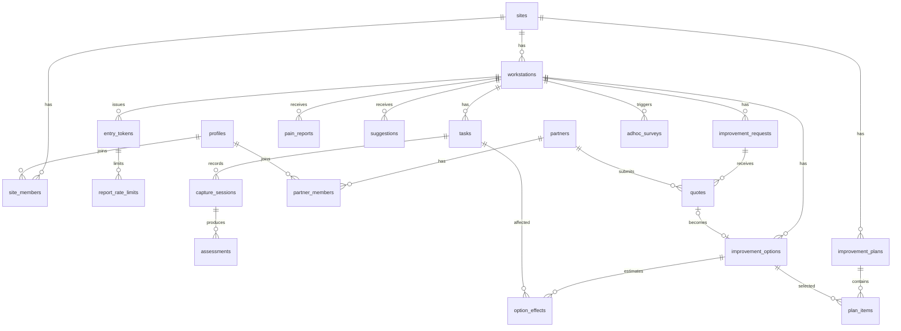

# 데이터 모델 (v1)

도메인 용어와 코드 식별자는 CLAUDE.md의 매핑을 따른다. 테이블은 Supabase(Postgres)에 두고, 변경은 supabase/migrations/의 SQL로만 한다.

## 설계 원칙
- 작업자는 계정이 없다. pain_reports, suggestions에는 작성자를 가리키는 열을 두지 않는다.
- 촬영 영상과 원본 관절 좌표 시계열은 저장하지 않는다. 서버가 재계산한 결과(assessments)만 저장한다.
  (무료 플랜 DB 500MB 기준, 원본 좌표를 저장하면 세션 약 1,000건에서 용량이 찰 수 있다는 어림 계산에 따른 결정. 실측 아님)
- 점수와 최적화 결과에는 계산 기준의 버전을 남긴다 (algorithm_version, solver_version).
- 관리자는 통증 신고 테이블을 직접 읽지 않는다. 합산·지연 규칙을 적용한 집계 뷰만 읽는다.

## ERD

## 테이블
| 테이블 | 주요 열 | 비고 |
|---|---|---|
| sites | id, name, created_at | 사업장 |
| workstations | id, site_id, parent_group, name, code, headcount | parent_group은 5명 미만 합산의 상위 단위(필수). code는 선택 입력, 같은 사업장 안에서 겹치지 않음 |
| tasks | id, workstation_id, name, daily_hours, load_category, load_shock, coupling, static_hold, unstable_base, sitting, arm_supported | 단위작업. 하루 작업 시간과 REBA 관리자 입력 항목 (docs/assessment-rules.md). workstation_id는 바꿀 수 없음(트리거) |
| profiles | id (auth.users.id), role (manager, partner), display_name | 작업자 행은 없음 |
| site_members | site_id, profile_id | 관리자의 소속 사업장 |
| partners | id, company_name | 설비 업체 |
| partner_members | partner_id, profile_id | |
| entry_tokens | id, workstation_id, token_hash, active, expires_at | QR 토큰. 원문은 저장하지 않음. 공정당 활성 토큰은 하나(부분 고유 인덱스). 발급·재발급은 issue_entry_token 함수가 기존 토큰 비활성화와 새 토큰 추가를 한 트랜잭션에서 처리한다. 비활성 토큰은 바꿀 수 없고, 만료일은 지금부터 90일 뒤까지만 정할 수 있다 |
| report_rate_limits | token_id, kind (pain, assessment), window_start, count | 토큰별·요청 종류별 시간당 요청 수 제한(정시 기준 고정 창). 개인 정보 없음 |
| capture_sessions | id, task_id, frame_count, inference_fps, created_at | 원본 좌표 미저장 |
| assessments | id, session_id, method (reba, rula), part_summary (jsonb), valid_frame_ratio, high_risk_ratio, score_p90, level, algorithm_version, created_at | 서버 재계산 결과 (docs/assessment-rules.md 세션 결과) |
| pain_reports | id, workstation_id, body_parts (text[]), intensity, created_at, visible_from | 작성자 열 없음 |
| suggestions | id, workstation_id, body, status, created_at | 작성자 열 없음 |
| improvement_options | id, workstation_id, title, description, cost, expected_risk_reduction, duration_days, quote_id | description은 500자 이하. workstation_id는 바꿀 수 없음(트리거). expected_risk_reduction, duration_days, quote_id는 현재 쓰지 않음. 감소량은 최신 평가가 바뀌면 달라지므로 저장하지 않고 화면에서 계산한다 |
| option_effects | option_id, task_id, expected_high_risk_ratio, source (simulation, manual), capture_id | 개선안 적용 후 단위작업별 예상 고위험 비율 (docs/optimization-model.md). 단위작업은 개선안과 같은 공정이어야 함(트리거). 단위작업당 효과 하나(기본 키 option_id, task_id). simulation이면 capture_id가 그 시연 촬영을 가리키고, manual이면 null이다. 관리자는 manual만 쓸 수 있고 simulation은 save_simulation_capture만 쓴다 |
| simulation_tokens | id, token_hash, option_id, task_id, created_by, created_at, expires_at, used_at | 시연 촬영용 일회용 토큰. 원문은 저장하지 않음. 15분 유효, 효과를 한 번 저장하면 used_at이 남고 다시 쓸 수 없다. 발급은 issue_simulation_token만 한다 |
| simulation_captures | id, option_id, task_id, frame_count, inference_fps, task_inputs (jsonb), part_summary, valid_frame_ratio, high_risk_ratio, score_p90, level, algorithm_version, created_at | 시연 촬영 이력. 서버가 평가와 같은 알고리즘과 품질 기준으로 계산한다. task_inputs는 채점에 쓴 단위작업의 관리자 입력이다. capture_sessions, assessments와 분리해 최신 평가, 개요, 보고서 평가, 통증 집계에 섞이지 않는다. 다시 찍어도 지우지 않는다 |
| improvement_requests | id, workstation_id, status, created_by | created_by는 관리자 profile. 기본값 auth.uid(), 추가 시 본인만 허용 |
| quotes | id, request_id, partner_id, price, lead_time_days, status | |
| improvement_plans | id, site_id, budget, solver_version, total_cost, total_reduction, exposure_before, warnings (jsonb), created_by, created_at | 저장 시점의 계산 결과를 그대로 남긴다. 쓰기는 서버의 save_improvement_plan만 한다. created_by는 저장한 관리자. total_cost, total_reduction은 항목의 합 |
| plan_items | plan_id, workstation_id, workstation_name, option_id, option_title, cost, reduction, manual_estimate | 공정당 하나(기본 키 plan_id, workstation_id). 저장 시점 값을 복사해 두어 개선안을 고치거나 지워도 계획은 바뀌지 않는다. 개선안이 지워지면 option_id는 null |
| adhoc_surveys | id, workstation_id, trigger_reason, occurred_on, due_date, status, completed_on, note, created_at | 제657조 제2항의 사유로 시작한 수시 조사. due_date는 occurred_on부터 1개월(계산은 docs/console-metrics.md "수시 조사"). 공정당 진행 중(open) 조사는 하나(부분 고유 인덱스). status = done이면 completed_on이 있고 발생일 이후다. note는 500자 이하이며 개인 정보를 적지 않는다 |

## 집계 뷰: workstation_pain_summary
- parent_group 안에 5명 미만 공정이 하나라도 있으면 그 parent_group 전체를 한 행으로 합산한다.
  같은 그룹의 다른 공정이 반드시 함께 묶이므로 차감 역산을 막는다.
- 공정이 하나뿐이거나 합친 인원이 5명 미만인 그룹은 행을 내보내지 않는다.
- 5명 미만 공정의 신고는 visible_from이 지난 것만 집계한다. visible_from은 신고 시각에 지연 시간을 더해 저장한다.
  visible_from은 DB 트리거가 채우며, 요청에 담긴 값은 덮어쓴다.
- 지연 시간: 24시간 (확정)
- 행 단위: 사업장, 표시 단위(공정 이름 또는 합산된 parent_group), 주(월요일 시작, Asia/Seoul).
  열: 신고 수, 정도별 수, 부위별 수. 개별 신고 시각은 노출하지 않는다.
- 사업장 단위 합계는 workstation_pain_summary의 표시 가능한 행만 더해서 계산한다.
  pain_reports를 직접 세지 않는다. 숨긴 그룹의 신고 수가 차감으로 드러나는 것을 막기 위해서다.
- 합산 규칙은 pain_group_visibility 뷰 한 곳에 두고, 집계 뷰는 이 뷰를 읽는다.

## 그룹 표시 여부 뷰: pain_group_visibility
- workstations만 읽고 pain_reports는 읽지 않는다. 신고가 있는지 여부도 드러나지 않는다.
- 호출한 사용자의 권한으로 실행한다(security_invoker). workstations의 RLS가 그대로 적용된다.
- 열: site_id, parent_group, workstation_count, merged, visible, reason (single_workstation, under_five)
- 콘솔은 visible = false인 그룹에 "그룹 설정을 바꿔야 신고를 볼 수 있다"는 안내를 띄운다.

## 최신 평가 뷰: task_latest_assessments
- 단위작업마다 method = reba인 최신 평가 1건 (같은 시각이면 id가 큰 행).
- 열: task_id, high_risk_ratio, level, score_p90, created_at, valid_frame_ratio, algorithm_version, part_summary
- 호출한 사용자의 권한으로 실행한다(security_invoker). capture_sessions와 assessments의 RLS가 그대로 적용된다.
- 콘솔 개요 지표의 입력이다 (docs/console-metrics.md).

## 허용 값
| 열 | 값 |
|---|---|
| tasks.load_category | lt5, 5to10, gt10 |
| tasks.coupling | good, fair, poor, unacceptable |
| pain_reports.body_parts | neck, shoulder, arm_elbow, hand_wrist, lower_back, leg_foot (증상조사표와 같음) |
| pain_reports.intensity | mild, moderate, severe, very_severe (증상조사표와 같음) |
| assessments.level | low, caution, high, very-high (web/src/components/risk.ts와 같음) |
| suggestions.status | new, reviewed, closed |
| improvement_requests.status | draft, open, closed. 파트너는 open만 읽는다 |
| quotes.status | submitted, accepted, rejected |
| adhoc_surveys.status | open, done |
| adhoc_surveys.trigger_reason | disease, new_work, work_change (제657조 제2항 제1호, 제2호, 제3호). 통증 신고 누적은 사유가 아니다 |

## DB 함수 (작업자 저장)
- 작업자 저장은 Route Handler가 service_role로 아래 함수를 호출해 한 트랜잭션에서 처리한다. 다른 역할은 실행할 수 없다.
- save_assessment: 토큰 유효성과 단위작업의 공정을 확인하고, 촬영 저장 횟수를 올린 뒤 capture_sessions와 assessments를 함께 저장한다.
  점수는 서버가 tasks의 관리자 입력으로 다시 계산한 값만 받는다. 제한에 걸리면 아무것도 저장하지 않고 false를 돌려준다.
- submit_pain_report: 토큰 유효성을 확인하고 공정은 토큰에서 찾는다. 신고 횟수를 올린 뒤 pain_reports에 저장한다.
  visible_from은 트리거가 채운다. 제한에 걸리면 저장하지 않고 false를 돌려준다.
- 제한 횟수는 정시 기준 고정 창(date_trunc('hour'))으로 센다. 창의 경계 전후로 최대 두 배까지 연달아 들어올 수 있다.
- 지난 시간 창의 행은 지우지 않는다(토큰·종류별 시간당 1행).

## DB 함수 (개선안 저장)
- save_improvement_option: 개선안 추가·수정과 manual 효과 교체를 한 트랜잭션에서 처리한다. 효과는 source = manual로 저장한다.
- 호출한 사용자의 권한으로 실행한다(security invoker). RLS가 그대로 적용되어, 관리자는 소속 사업장 공정의 개선안만 저장할 수 있다. authenticated만 실행할 수 있다.
- 수정할 때 그 개선안의 manual 효과만 지우고 다시 넣는다. simulation 효과는 남는다. simulation 효과가 있는 단위작업에 manual 값을 보내면 기본 키 충돌(unique_violation)로 저장하지 않는다.
- 삭제는 improvement_options 행 삭제 한 번으로 하며, 효과는 cascade로 함께 지워진다.

## DB 함수 (시연 촬영)
- issue_simulation_token: 콘솔이 부른다. security definer로 실행하고, 함수 안에서 호출한 사용자가 개선안 공정의 사업장 manager인지(private.managed_workstation_ids, auth.uid() 기준), 단위작업이 같은 공정인지 확인한다. 관리자당 최근 1시간에 20개까지 발급한다(사용자별 advisory lock으로 동시 요청을 줄 세운다). authenticated만 실행할 수 있다. 관리자에게 simulation_tokens 쓰기 권한이 없어 이 함수를 거치지 않고는 토큰을 만들 수 없다.
- save_simulation_capture: Route Handler가 service_role로 부른다. 토큰을 잠그고 쓰지 않았고 만료 전인지 확인한 뒤, simulation_captures에 넣고 효과를 그 촬영 값으로 덮어쓰고(source = simulation) 토큰을 쓴 것으로 남긴다. 토큰이 쓰였거나 만료됐으면 아무것도 저장하지 않고 null을 돌려준다. service_role만 실행할 수 있다.
- 효과를 직접 입력으로 되돌릴 때는 관리자가 그 simulation 효과 행을 지운다. 촬영 이력은 남는다.

## DB 함수 (개선 계획 저장)
- save_improvement_plan: 콘솔 Server Action이 세션으로 관리자와 소속 사업장을 확인하고, 세션 권한으로 읽은 데이터로 계획을 다시 계산한 뒤 service_role로 호출한다. 다른 역할은 실행할 수 없다.
- 함수는 저장하는 관리자가 그 사업장 소속 manager인지, 모든 항목이 그 사업장의 현재 개선안이고 비용이 계산에 쓴 값과 같은지 확인한 뒤 계획과 항목을 한 트랜잭션에 넣는다. 개선안 이름과 공정 이름은 DB에서 복사한다.
- 계획의 total_cost와 total_reduction은 매개변수로 받지 않고, 저장하는 항목의 cost와 reduction을 함수 안에서 더한다. 계획의 합계와 항목의 합이 다를 수 없게 하기 위해서다.
- 계산과 저장 사이에 개선안 비용이 바뀌면 저장을 거부한다. 화면은 다시 계산하도록 안내한다.

## 권한 (RLS 요약)
| 테이블 | manager | partner | 작업자 (계정 없음) |
|---|---|---|---|
| sites, workstations, tasks | 소속 사업장만 읽기·쓰기 | 없음 | 직접 접근 없음 |
| capture_sessions, assessments | 소속 사업장만 읽기 | 없음 | Route Handler가 서버 권한으로 쓰기 |
| pain_reports, suggestions | 테이블 직접 읽기 없음, 집계 뷰만 | 없음 | Route Handler가 서버 권한으로 쓰기 |
| improvement_options, option_effects | 소속 사업장만 읽기·쓰기 (option_effects 쓰기는 manual만, simulation은 지우기만) | 없음 | 없음 |
| simulation_tokens, simulation_captures | 소속 사업장만 읽기 (token_hash는 못 읽음). 토큰 발급은 issue_simulation_token | 없음 | Route Handler가 서버 권한으로 토큰 확인과 촬영 저장 |
| improvement_plans, plan_items | 소속 사업장만 읽기 (쓰기는 서버 함수) | 없음 | 없음 |
| improvement_requests | 소속 사업장만 읽기·쓰기 | 공개된 요청(status = open)만 읽기 | 없음 |
| quotes | 소속 사업장 요청의 견적 읽기 | 자기 회사 견적만 읽기·쓰기 | 없음 |
| entry_tokens, report_rate_limits | 소속 사업장 토큰 발급·비활성화·기간 연장 | 없음 | Route Handler만 조회 |
| adhoc_surveys | 소속 사업장만 읽기·쓰기 | 없음 | 없음 |

- 신규 Supabase 프로젝트는 Data API에 쓰려면 테이블별 Postgres 권한을 명시적으로 부여해야 한다. 마이그레이션에 권한 부여를 함께 둔다.

## 미결정
- 원본 좌표를 나중에 다른 알고리즘으로 재계산할 필요가 생길 경우의 저장 방식

## 확정
- 통증 부위와 정도의 허용 값: 증상조사표 원문과 같음(고시 제2020-12호 별지 제2호서식, 2026-10-23 확인). 좌우, 지속 기간, 빈도, 치료 여부, 직업력은 들림에 없음
- 5명 미만 공정 신고의 지연 시간: 24시간
- 토큰별 신고 수 제한: 시간당 20건 (정시 기준 고정 창)
- 토큰별 촬영 저장 제한: 시간당 10건 (시작값, 정시 기준 고정 창). 같은 QR로 반복 촬영을 보내 공정 위험도를 부풀리는 것을 막는다
