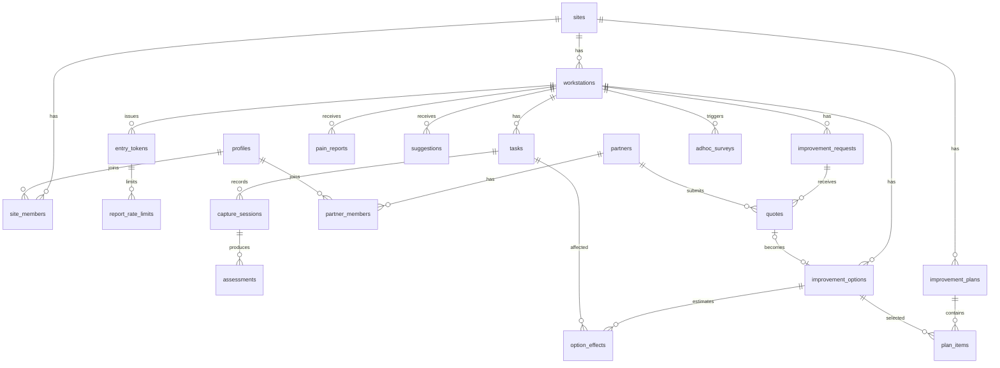

# 데이터 모델 (v1)

도메인 용어와 코드 식별자는 CLAUDE.md의 매핑을 따른다. 테이블은 Supabase(Postgres)에 두고, 변경은 supabase/migrations/의 SQL로만 한다.

## 설계 원칙
- 작업자는 계정이 없다. pain_reports, suggestions에는 작성자를 가리키는 열을 두지 않는다.
- 촬영 영상과 원본 관절 좌표 시계열은 저장하지 않는다. 서버가 재계산한 결과(assessments)만 저장한다.
  (무료 플랜 DB 500MB 기준, 원본 좌표를 저장하면 세션 약 1,000건에서 용량이 찰 수 있다는 어림 계산에 따른 결정. 실측 아님)
- 점수와 최적화 결과에는 계산 기준의 버전을 남긴다 (algorithm_version, solver_version).
- 관리자는 통증 신고 테이블을 직접 읽지 않는다. 합산·지연 규칙을 적용한 집계 뷰만 읽는다.

## ERD

## 테이블
| 테이블 | 주요 열 | 비고 |
|---|---|---|
| sites | id, name, created_at | 사업장 |
| workstations | id, site_id, parent_group, name, headcount | parent_group은 5명 미만 합산의 상위 단위 |
| tasks | id, workstation_id, name, daily_hours, load_category, load_shock, coupling, static_hold, unstable_base, sitting, arm_supported | 단위작업. 하루 작업 시간과 REBA 관리자 입력 항목 (docs/assessment-rules.md) |
| profiles | id (auth.users.id), role (manager, partner), display_name | 작업자 행은 없음 |
| site_members | site_id, profile_id | 관리자의 소속 사업장 |
| partners | id, company_name | 설비 업체 |
| partner_members | partner_id, profile_id | |
| entry_tokens | id, workstation_id, token_hash, active, expires_at | QR 토큰. 원문은 저장하지 않음 |
| report_rate_limits | token_id, window_start, count | 토큰별 신고 수 제한. 개인 정보 없음 |
| capture_sessions | id, task_id, frame_count, inference_fps, created_at | 원본 좌표 미저장 |
| assessments | id, session_id, method (reba, rula), part_summary (jsonb), high_risk_ratio, algorithm_version | 서버 재계산 결과 |
| pain_reports | id, workstation_id, body_parts (text[]), intensity, created_at, visible_from | 작성자 열 없음 |
| suggestions | id, workstation_id, body, status, created_at | 작성자 열 없음 |
| improvement_options | id, workstation_id, title, cost, expected_risk_reduction, duration_days, quote_id | |
| option_effects | option_id, task_id, expected_high_risk_ratio, source (simulation, manual) | 개선안 적용 후 단위작업별 예상 고위험 비율 (docs/optimization-model.md) |
| improvement_requests | id, workstation_id, status, created_by | created_by는 관리자 profile |
| quotes | id, request_id, partner_id, price, lead_time_days, status | |
| improvement_plans | id, site_id, budget, solver_version, created_by, created_at | |
| plan_items | plan_id, option_id | |
| adhoc_surveys | id, workstation_id, trigger_reason, due_date, status | due_date는 사유 발생 후 1개월 (제657조 제2항) |

## 집계 뷰: workstation_pain_summary
- headcount 5명 미만 공정은 단독으로 노출하지 않고 parent_group 단위로 합산한다.
- 합산 대상 공정이 생기면 같은 parent_group의 다른 공정을 하나 이상 함께 묶어 차감 역산을 막는다.
- 5명 미만 공정의 신고는 visible_from이 지난 것만 집계한다. visible_from은 신고 시각에 지연 시간을 더해 저장한다.
- 지연 시간: TBD (기본값 제안 24시간)

## 권한 (RLS 요약)
| 테이블 | manager | partner | 작업자 (계정 없음) |
|---|---|---|---|
| sites, workstations, tasks | 소속 사업장만 읽기·쓰기 | 없음 | 직접 접근 없음 |
| capture_sessions, assessments | 소속 사업장만 읽기 | 없음 | Route Handler가 서버 권한으로 쓰기 |
| pain_reports, suggestions | 테이블 직접 읽기 없음, 집계 뷰만 | 없음 | Route Handler가 서버 권한으로 쓰기 |
| improvement_options, option_effects, improvement_plans, plan_items | 소속 사업장만 읽기·쓰기 | 없음 | 없음 |
| improvement_requests | 소속 사업장만 읽기·쓰기 | 공개된 요청만 읽기 | 없음 |
| quotes | 소속 사업장 요청의 견적 읽기 | 자기 회사 견적만 읽기·쓰기 | 없음 |
| entry_tokens, report_rate_limits | 소속 사업장 토큰 발급·비활성화 | 없음 | Route Handler만 조회 |
| adhoc_surveys | 소속 사업장만 읽기·쓰기 | 없음 | 없음 |

- 신규 Supabase 프로젝트는 Data API에 쓰려면 테이블별 Postgres 권한을 명시적으로 부여해야 한다. 마이그레이션에 권한 부여를 함께 둔다.

## 미결정
- 5명 미만 공정 신고의 지연 시간 (제안 24시간)
- 토큰별 신고 수 제한값 (제안: 시간당 20건)
- 원본 좌표를 나중에 다른 알고리즘으로 재계산할 필요가 생길 경우의 저장 방식
